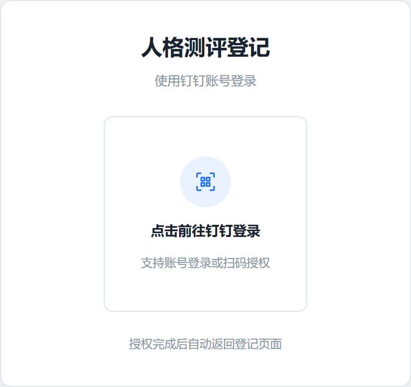
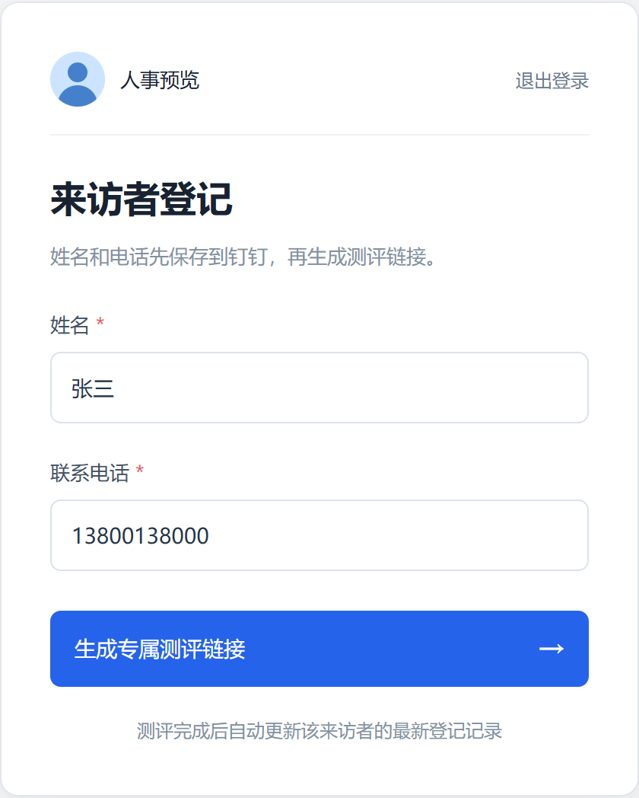
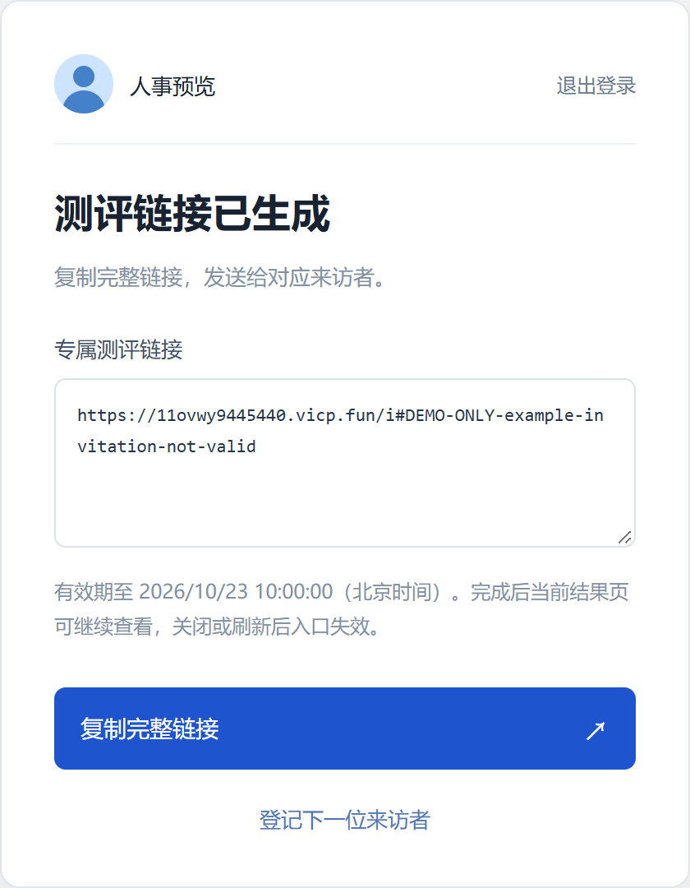
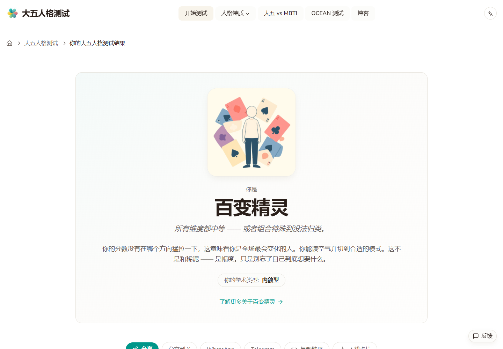

# 人格测评使用指南

**人事登记并发送链接，来访者完成测评，结果自动回填到本表格。**

入口：[打开人格测评登记页面](https://11ovwy9445440.vicp.fun/)

> 当前为临时测试地址。下方登记截图使用演示资料，示例邀请链接不可使用。

## 1. 人事使用钉钉登录

打开入口，点击「点击前往钉钉登录」，按提示使用账号或扫码授权，随后自动返回登记页。已有有效登录时，直接进入登记页。

## 2. 填写姓名和电话

填写来访者信息，核对无误后点击「生成专属测评链接」。

- **姓名**：必填，只能填写中文汉字，不能带空格、数字或其他符号。
- **联系电话**：必填，填写正确的中国大陆 11 位手机号，无需填写 +86。

## 3. 复制链接，发送给来访者

显示「测评链接已生成」时，姓名和电话已保存到本表格。点击「复制完整链接」，将链接发送给对应来访者；登记下一位时，点击「登记下一位来访者」。

**一人一链接，请完整复制，不要让多人共用。**

## 4. 来访者测评，人事查看结果

来访者打开链接即可开始测评，**无需登录钉钉，也无需再次填写姓名和电话**。请在同一浏览器按原站提示如实作答，提交后等待正式报告生成。

测评完成后，可直接查看原站报告。本表格会自动回填**五维分数、人格类型、描述和报告链接**，无需手动复制。写入时间、更新时间由表格自动记录。

## 使用提醒

- 邀请有效期为 **3 天（72 小时）**，具体到期时间见链接生成页。过期后，请联系人事重新生成。
- 完成测评后，当前报告页可继续查看；**关闭或刷新后，临时测评入口失效**。后续可通过表格中的报告链接查看结果。
- 请勿修改已登记行的姓名、电话。同一人尽量不要同时使用多个邀请；结果会匹配姓名、电话相同且写入时间最新的记录。
- 表格只有姓名和电话、结果暂时为空，表示已登记但尚未回填。后台会自动重试回传；长时间未更新或遇到错误时，请联系管理员，避免重复登记。
